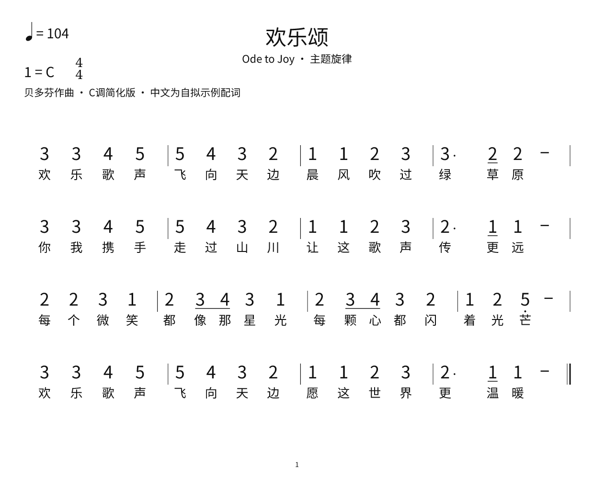
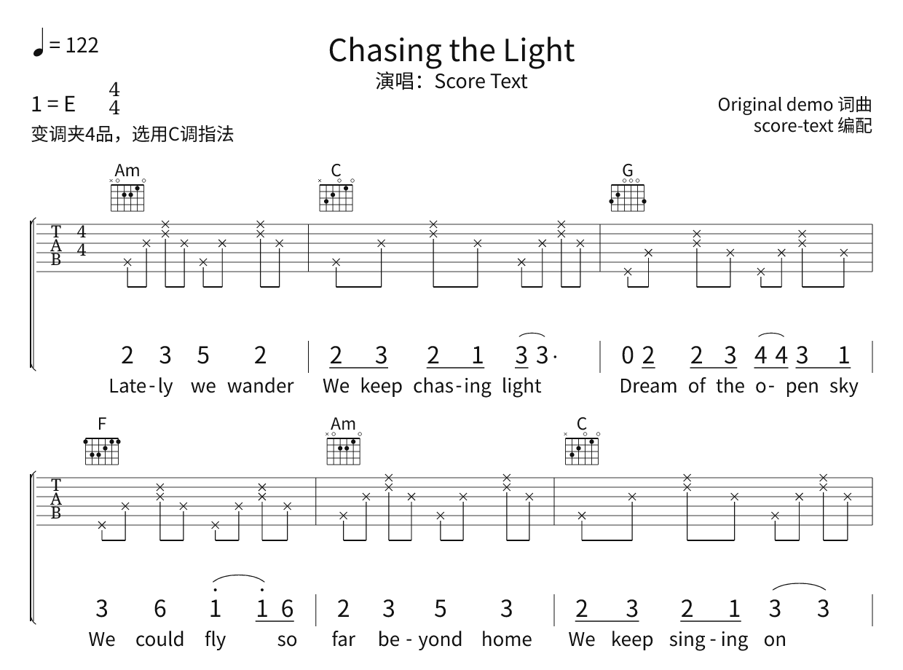

# score-text

给 agent 使用的纯文本多声部乐谱排版 CLI。用常见 YAML 写乐谱，离线输出 **PDF / SVG / PNG / HTML**，另可输出 **MIDI / MusicXML / JSON**。

[](https://github.com/tairuiqu/score-text/actions/workflows/ci.yml)
[](https://www.npmjs.com/package/score-text)

默认样式参照本项目需求提供的流行歌曲谱例：居中标题、左上速度与调号、右侧编配信息、和弦指法图、六线谱、下方简谱与歌词。支持吉他弦品数字、叉头节奏型与扫弦箭头，也支持钢琴双谱表和打击乐五线谱。

## 安装与使用

需要 Node.js 20 或更新版本，不需要模型 API、浏览器、LilyPond 或系统字体。

```sh
npm install -g score-text
score-text init song.score.yaml
score-text validate song.score.yaml --json
score-text render song.score.yaml -o song.pdf --json
```

也可以免全局安装运行：

```sh
npx --yes score-text init song.score.yaml
npx --yes score-text render song.score.yaml -o song.pdf
```

也可从 GitHub [Releases](https://github.com/tairuiqu/score-text/releases) 下载 `.tgz` 文件，使用 `npm install -g ./score-text.tgz` 安装。

## 效果示例

《欢乐颂》C 调简谱，中文为自拟排版示例配词：



吉他叉头六线谱、和弦指法图与中英文歌词：



查看 [`examples/`](examples/) 中的完整文本输入；GitHub [Releases](https://github.com/tairuiqu/score-text/releases) 提供 PDF 示例与可安装的 npm 压缩包。

## 从源码运行

```sh
git clone https://github.com/tairuiqu/score-text.git
cd score-text
npm ci
npm run build
node dist/cli.js init song.score.yaml
node dist/cli.js validate song.score.yaml --json
node dist/cli.js render song.score.yaml -o song.pdf --json
node dist/cli.js render song.score.yaml -o song.png
node dist/cli.js render song.score.yaml -o song.html
```

若希望直接使用 `score-text` 命令，在此目录运行 `npm link`。也可以直接运行 `npm start -- render ...`。

```sh
npm run demo
# output/reference-pop.pdf：叉头六线谱 + 简谱 + 中英文歌词
# output/strum-pop.pdf：扫弦箭头 + 简谱 + 歌词
# output/ensemble.pdf：人声 + 吉他 + 钢琴 + 鼓，4/4 → 6/8 → 3/4
# output/ode-to-joy.pdf：欢乐颂 16 小节主题简谱
```

## 文本长什么样

```yaml
version: 1
title: 星光
key: C
meter: 4/4
tempo: 108
tracks:
  guitar: { type: tab, mode: frets }
  vocal: { type: numbered, lyrics: true }
bars:
  - chords: C
    guitar: "5:3/8 4:2/8 3:0/8 2:1/8 1:0/8 2:1/8 3:0/8 2:1/8"
    vocal:
      notes: "1/4 2/8 3/8 5/4 3/4"
      lyrics: [星, 光, 落, 在, 肩]
  - meter: 6/8
    tempo: { bpm: 72, unit: "4." }
    chords: Am
    guitar: "5:0/8 3:2/8 2:1/8 1:0/8 2:1/8 3:2/8"
    vocal:
      notes: "6v/8 1/8 2/8 3/4."
      lyrics: [陪, 我, 走, 远]
```

`3/8` = 八分音符的“3”；`C#4/4` = 升 C4 四分音符；`5:3/8` = 吉他第 5 弦第 3 品八分音符。默认不继承省略的时值，每个音符都写清楚。也可以全部展开成普通对象：

```yaml
notes:
  - { pitch: 3, duration: 8, lyric: 星 }
  - { pitch: 5, duration: "4.", lyric: 光 }
  - { rest: true, duration: 2 }
```

每个 `bars` 元素就是一个小节。各 voice 必须填满当前小节；漏写整个声部会自动变为全小节休止。拍号与调性从变更处延续。速度可按小节、在小节内指定 `tempoChanges`，或用 `ramp: {to: 120, bars: 2}` 表示渐变。

## Agent 接口

```sh
score-text guide
score-text schema
score-text validate song.score.yaml --json
score-text inspect song.score.yaml --json
score-text render song.score.yaml -o song.pdf --json
# stdin：把上一步产生的 YAML 直接送入工具
cat song.score.yaml | score-text render - -o song.svg --json
```

成功退出码为 `0`，失败为 `1`。`--json` 输出带 `ok` 的单行结果；错误写入 stderr，含诊断码、对象路径与说明，便于 agent 定位并修复。例如：

```json
{"ok":false,"diagnostics":[{"code":"BAR_DURATION","path":"bars[0].vocal.1","message":"时值合计 2 个四分音符；应为 4（4/4）"}]}
```

可在编辑器中关联 [`schema/score-text.schema.json`](schema/score-text.schema.json)。面向 agent 的完整生成约定在 [`docs/agent-guide.md`](docs/agent-guide.md)，语法在 [`docs/notation.md`](docs/notation.md)。

## 排版和输出

- 所有声部共享小节内的 tick 时间轴。音符、歌词和和弦各自施加间距约束，工具自动换行与分页。
- `layout.barsPerSystem` 是每行小节数的上限；空间不足会减少小节数。`break: true` / `pageBreak: true` 可以手动断行或分页。
- SVG 和 PDF 使用字体轮廓，PNG 从同一 SVG 渲染，不受接收方字体安装影响。PDF 是矢量图。
- 多页 SVG / PNG 自动输出 `name-1.svg`、`name-2.svg` 等；PDF / HTML 包含所有页。命令的 `files` 字段列出实际文件。
- PDF 宽度为 A4 的 595.28 pt，高度按 `layout.height / layout.width` 等比缩放。默认 `1240 × 1754` 接近 A4。
- HTML 可离线打开、打印和保存 PDF，无 CDN 和外部脚本。

## 开发与验证

```sh
npm test
npm run build
npm run smoke:package
npm run demo
uv run --with lxml --with pymupdf python scripts/verify-exports.py
```

自动化测试覆盖时值、歌词校验、多声部、转拍、连音、渐变速度、独立 MIDI 解码、所有导出格式和 CLI。最后一条命令使用 W3C 官方 MusicXML 4.0 XSD 验证实际导出，并重新栅格化 PDF 到 `tmp/qa/`。

调研与设计理由见 [`docs/research.md`](docs/research.md)。代码是 TypeScript，入口 API 见 [`src/index.ts`](src/index.ts)。

版本发布使用 GitHub Actions：推送与 `package.json` 版本一致的 `v*` 标签后，自动完成 Windows / Ubuntu 验证、npm OIDC 可信发布和 GitHub Release 附件上传。操作步骤见 [`docs/publishing.md`](docs/publishing.md)。

## 范围

当前是可使用的 v1，重点覆盖流行歌曲、吉他弹唱与小型合奏。支持歌词、和弦图、和弦音、多 voice、常用时值与连音组、弱起、升降号、延音线和连音线、反复线、力度和重音。复杂出版需求中的装饰音、跨谱表符梁、嵌套连音线、微分音和吉他推弦等技法尚未实现。

MIDI 用于校对音高、节奏、拍号和速度：按书面小节顺序播放，**不展开反复线**。吉他弦品按 capo 升高；叉头与扫弦根据已知和弦指法发声，未指定可用指法时扫弦静音；扫弦的弦间时间差没有模拟。MIDI 最多 15 个独立有音高声部，鼓使用通道 10。

MusicXML 是语义交换格式：简谱转换成实际音高的五线谱，外部编辑器重新排版后不保证本工具的视觉样式；扫码/图片识别和音频转谱不在范围内。

源代码 MIT；打包的 Bravura 和 Noto 字体使用 SIL Open Font License，见 `assets/fonts/` 中的许可文件。
